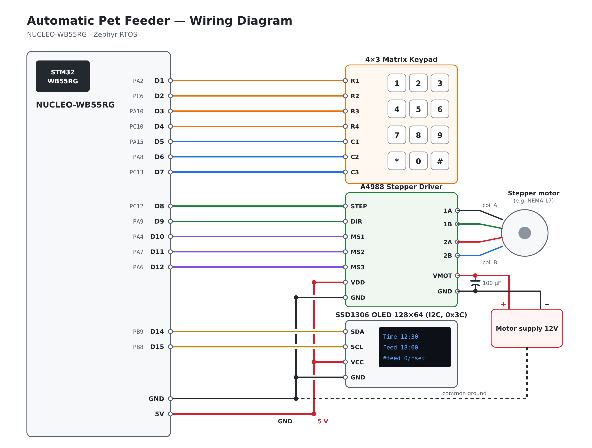

# Automatic Pet Feeder (Zephyr RTOS, STM32WB55)

An embedded pet feeder built on the **NUCLEO-WB55RG** board running **Zephyr RTOS**.
It keeps the time, shows it on an OLED display, and feeds the pet once a day at a
scheduled time by turning a stepper-driven dispenser. Feeding can also be started
manually from the keypad.

> **Project status:** this is a small student project and a work in progress.
> The core functionality works, but the design still has known limitations
> (see [Possible improvements](#possible-improvements)) that are planned to be
> addressed in future versions.

<!-- Add a photo or GIF of the working device here: -->
<!--  -->

## Features

- Clock shown on a 128×64 SSD1306 OLED (I2C)
- Daily scheduled feeding plus a manual "feed now" key
- Time entry from a 4×3 matrix keypad, with validation (rejects hours above 23 and minutes above 59)
- Stepper motor control through an A4988 STEP/DIR driver in half-step mode
- Pin mapping defined in a devicetree overlay, with no hard-coded pins in the code

## Hardware

| Component | Notes |
|---|---|
| NUCLEO-WB55RG | STM32WB55 (Cortex-M4) development board |
| SSD1306 OLED 128×64 | I2C, address `0x3C` |
| 4×3 matrix keypad | 4 rows, 3 columns |
| Stepper motor + A4988 driver | STEP/DIR interface, MS1–MS3 for microstepping |
| 12 V power supply | For the motor driver (VMOT) |

### Wiring

| Signal | MCU pin | Arduino header |
|---|---|---|
| OLED SCL | PB8 | D15 |
| OLED SDA | PB9 | D14 |
| Keypad row 0 | PA2 | D1 |
| Keypad row 1 | PC6 | D2 |
| Keypad row 2 | PA10 | D3 |
| Keypad row 3 | PC10 | D4 |
| Keypad col 0 | PA15 | D5 |
| Keypad col 1 | PA8 | D6 |
| Keypad col 2 | PC13 | D7 |
| A4988 STEP | PC12 | D8 |
| A4988 DIR | PA9 | D9 |
| A4988 MS1 | PA4 | D10 |
| A4988 MS2 | PA7 | D11 |
| A4988 MS3 | PA6 | D12 |

The full pin mapping is defined in [`boards/nucleo_wb55rg.overlay`](boards/nucleo_wb55rg.overlay).



## Usage

| Key | Action |
|---|---|
| `#` | Feed now |
| `0` | Set the current time |
| `*` | Set the daily feeding time |

When setting a time, type 4 digits in `HHMM` format and press `#` to confirm.

## Building and flashing

This project requires a [Zephyr development environment](https://docs.zephyrproject.org/latest/develop/getting_started/index.html).

```bash
west build -b nucleo_wb55rg path/to/pet-feeder
west flash
```

## Project structure

```
pet-feeder/
├── CMakeLists.txt
├── prj.conf                    # Kconfig options (GPIO, I2C, display)
├── boards/
│   └── nucleo_wb55rg.overlay   # Devicetree: pins, OLED on I2C1
├── docs/
│   └── wiring.png              # Wiring diagram
└── src/
    └── main.c                  # Application
```

## Possible improvements

- Derive the clock from `k_uptime_get()` or the STM32 hardware RTC instead of counting `k_msleep()` calls, so it doesn't drift while the motor runs or a menu is open
- Poll the keypad more often (every ~20 ms), with debouncing, so short key presses are never missed
- Add backspace and cancel to time entry
- Store the feeding schedule in flash (Zephyr settings / NVS) so it survives a power loss
- Replace the 4×3 keypad with a 4×4 keypad (extra `A`–`D` keys) to build a proper menu system. The current keypad has too few keys for a comfortable menu. With more keys the user could, for example, choose how many feedings per day they want (say 4) and then set a time for each one (10:00, 12:00, 15:00 and 20:00)
- Adjustable portion size for each feeding
- Add a BLE interface (the STM32WB55 has a built-in BLE radio) to control the feeder from a phone

## License

[MIT](LICENSE)
